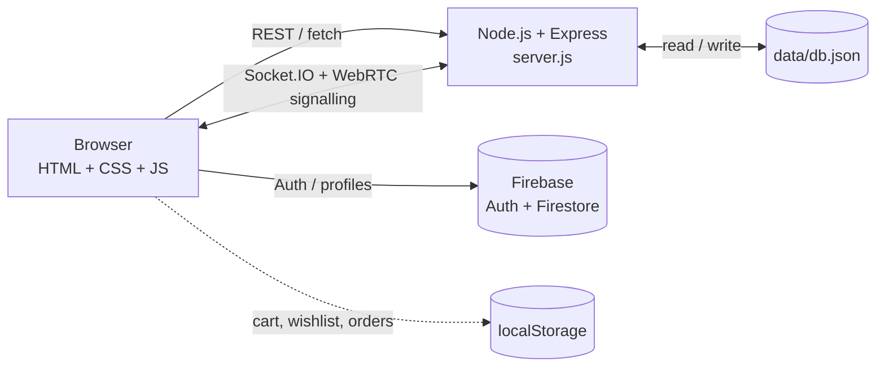

# HealthKart
#Preview Link
https://relaxed-patient-9c2818.netlify.app/

[Upload<div align="center">

# 💚 HealthKart

### Healthcare Made Simple & Affordable

Search medicines · Compare prices · Consult doctors · Manage your health — all in one place.

**🔗 Live Preview: [relaxed-patient-9c2818.netlify.app](https://relaxed-patient-9c2818.netlify.app/)**

[](https://relaxed-patient-9c2818.netlify.app/)


**Built by Team PharmaCoders**

</div>

---

## 📖 About

Healthcare tasks are usually scattered across different apps: one to find medicines, another to book a doctor, another to keep prescriptions. **HealthKart** brings them into one connected journey:

> **Search → Compare → Consult → Connect → Manage**

Patients can discover medicines, compare prices, book doctors, join live video consultations, receive digital prescriptions and get medicine reminders. Doctors have their own dashboard to manage appointments and issue prescriptions during a call.

## ✨ Features

| | Feature | Details |
|---|---|---|
| 🔍 | **Medicine search** | Browse and search medicines and health devices, with detail pages |
| ⚖️ | **Price comparison** | Compare products side by side before buying |
| 🛒 | **Cart, wishlist, checkout** | Add to cart, save favourites, place orders, view order history |
| 🩺 | **Doctor directory** | Doctor listing with individual profile pages |
| 📅 | **Appointment booking** | Slot-based booking, cancellation and a "My Appointments" view |
| 📹 | **Video consultation** | WebRTC video calls with in-call chat, screen sharing and in-call prescriptions |
| 💊 | **Prescriptions** | Doctors issue prescriptions; patients view them in their account |
| ⏰ | **Reminders** | Medicine and yoga reminders, generated automatically from prescriptions |
| 🔔 | **Notifications** | Appointment and prescription alerts with mark-as-read |
| 🗂️ | **Health records** | Personal records on the "My Health" page |
| 🤖 | **AI health agent** | Answers questions, explains medicines, schedules reminders from plain text (*"remind me to take my medicine at 8 pm"*) |
| 🧭 | **Symptom triage** | Describe symptoms to get a suggested specialty, urgency level and doctor |
| 🔐 | **Authentication** | Sign up and log in with Firebase Auth, with patient and doctor flows |

> **Note:** The AI agent and triage are **rule-based** (keyword and intent matching) and run on the project's own server. They are not connected to an external LLM and are not a substitute for professional medical advice.

## 🧰 Tech Stack

| Layer | Technology |
|---|---|
| Frontend | HTML5, CSS3, vanilla JavaScript (ES modules), Font Awesome 6 |
| Backend | Node.js, Express 5, CORS |
| Real-time | Socket.IO 4 (signalling, chat, call events) and WebRTC (media) |
| Auth & cloud | Firebase Authentication, Cloud Firestore |
| Data store | JSON file (`data/db.json`) managed by the server |
| Client storage | `localStorage` for cart, wishlist, orders and health records |

## 🏗️ Architecture



## 📁 Project Structure

```
HealthKart/
├── index.html            # Landing page
├── style.css             # Global styles
├── server.js             # Express + Socket.IO server and REST API
├── firestore.rules       # Firestore security rules
├── pages/                # App pages (search, compare, doctors, cart, login, ...)
├── css/                  # Per-page stylesheets
├── js/                   # Per-page scripts (auth, cart, appointment, ai-agent, ...)
├── images/               # Doctor photos and product images
├── scripts/              # Test and helper scripts
└── scratch/              # Ad-hoc test scripts from development
```

## 🚀 Getting Started

**Requirements:** [Node.js](https://nodejs.org/) 18+ and npm. A modern browser with camera and microphone access is needed for video calls.

### 1. Clone and install

```bash
git clone https://github.com/priyanshukumarsingh8111/HealthKart.git
cd HealthKart
npm install
```

### 2. Create the data file

The server stores its data in `data/db.json`, which is not part of the repository. Create it with this one command (works on Windows, macOS and Linux):

```bash
node -e "const fs=require('fs');fs.mkdirSync('data',{recursive:true});fs.writeFileSync('data/db.json',JSON.stringify({doctors:[],medicines:[],appointments:[],bookedSlots:{},prescriptions:[],reminders:[],notifications:[]},null,2))"
```

Then add your own records to the `doctors` and `medicines` arrays. The Doctors and Medicines pages are built from `/api/doctors` and `/api/medicines`, so they stay empty until you do.

### 3. Start the app

```bash
npm start
```

Open **http://localhost:3000**. Set the `PORT` environment variable to use a different port.

### 4. Use your own Firebase project (optional)

1. Create a project in the [Firebase Console](https://console.firebase.google.com/) and enable **Authentication** (Email/Password) and **Cloud Firestore**.
2. Replace the config values in `js/firebase-config.js` with your project's web app config.
3. Review and tighten `firestore.rules`, then deploy them with `firebase deploy --only firestore:rules`.

### 5. Run the test scripts (optional)

With the server running, in a second terminal:

```bash
node scripts/test-all-features.js
node scripts/test-video-calling-flow.js
```

## 🔌 API Reference

Base URL: `http://localhost:3000`

<details>
<summary><b>Doctors & medicines</b></summary>

| Method | Endpoint | Description |
|---|---|---|
| `GET` | `/api/doctors` | List all doctors |
| `GET` | `/api/doctors/:id` | Get one doctor |
| `GET` | `/api/medicines` | List medicines |
| `GET` | `/api/medicines/:id` | Get one medicine |

</details>

<details>
<summary><b>Appointments</b></summary>

| Method | Endpoint | Description |
|---|---|---|
| `GET` | `/api/appointments/slots` | Available slots for a doctor on a date (`doctorId`, `date`) |
| `POST` | `/api/appointments/book` | Book an appointment |
| `GET` | `/api/appointments/my` | Appointments for the current patient |
| `GET` | `/api/appointments/doctor/:doctorId` | Appointments for a doctor |
| `POST` | `/api/appointments/:id/cancel` | Cancel an appointment |
| `POST` | `/api/appointments/:id/complete` | Mark an appointment as completed |
| `POST` | `/api/webrtc/verify-access` | Verify a user may join a call room |

</details>

<details>
<summary><b>Prescriptions, reminders & notifications</b></summary>

| Method | Endpoint | Description |
|---|---|---|
| `GET` | `/api/prescriptions` | List prescriptions (filter by `email`) |
| `GET` | `/api/prescriptions/:id` | Get one prescription |
| `POST` | `/api/prescriptions` | Issue a prescription (can generate reminders) |
| `GET` | `/api/reminders` | List reminders (filter by `email`) |
| `POST` | `/api/reminders` | Create a reminder |
| `PUT` | `/api/reminders/:id` | Update a reminder |
| `DELETE` | `/api/reminders/:id` | Delete a reminder |
| `GET` | `/api/notifications` | List notifications |
| `POST` | `/api/notifications/mark-read` | Mark notifications as read |

</details>

<details>
<summary><b>AI</b></summary>

| Method | Endpoint | Body |
|---|---|---|
| `POST` | `/api/ai/chat` | `{ "message": "...", "userEmail": "..." }` |
| `POST` | `/api/ai/triage` | `{ "symptoms": "..." }` |

</details>

<details>
<summary><b>Socket.IO events</b></summary>

| Event | Purpose |
|---|---|
| `register_user` | Register a connected user |
| `start_doctor_call` · `accept_doctor_call` · `decline_doctor_call` | Call lifecycle |
| `join_room` · `end_call` | Join and leave a consultation room |
| `webrtc_offer` · `webrtc_answer` · `ice_candidate` | WebRTC signalling |
| `in_call_chat` | Chat during a call |
| `in_call_prescription` | Send a prescription during a call |
| `screen_share_status` | Screen-share state updates |

</details>

## 🌐 Deployment

- **Static preview:** The [Netlify site](https://relaxed-patient-9c2818.netlify.app/) serves the frontend. Features that need the Node server (REST API, video calls, AI agent) require the backend to be running.
- **Full app:** Deploy `server.js` to any Node.js host (Render, Railway, a VPS, etc.). It serves both the frontend and the API from one origin. Set `PORT` if your host requires it.

## ⚠️ Known Limitations

HealthKart is a project prototype. Before production use:

- **JSON file storage** does not suit many concurrent users. Move to a real database.
- **Roles are inferred on the client** from the login email. Use server-verified roles (for example Firebase custom claims).
- **Some Firestore rules are open** (appointments and calls allow public read/write). Tighten them before going live.
- **No payment gateway.** Checkout stores orders locally in the browser.
- **Rule-based AI.** It gives general information only.

## 🗺️ Roadmap

- [ ] Production database in place of the JSON store
- [ ] Secure, server-verified authentication and roles
- [ ] Payment gateway integration
- [ ] Live pharmacy and inventory integrations
- [ ] TURN server for reliable video calls across networks
- [ ] LLM-powered health assistant with safety guardrails
- [ ] Automated tests and CI

## 🤝 Contributing

Contributions are welcome:

1. Fork the repository
2. Create a branch: `git checkout -b feature/your-feature`
3. Commit: `git commit -m "Add your feature"`
4. Push: `git push origin feature/your-feature`
5. Open a Pull Request

## 📄 License

Released under the **MIT License**. See [LICENSE](LICENSE).

## 👥 Team

**Team PharmaCoders** · Maintained by (https://github.com/priyanshukumarsingh8111)

---

<div align="center">

**If you find HealthKart useful, please give it a ⭐**

</div>
ing README (1).md…]()


